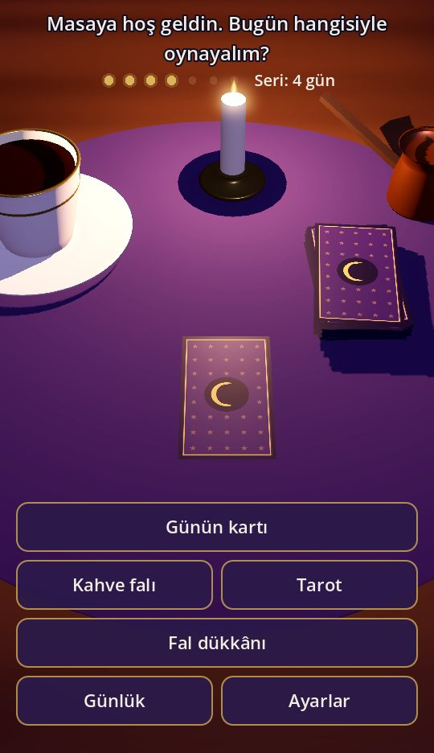
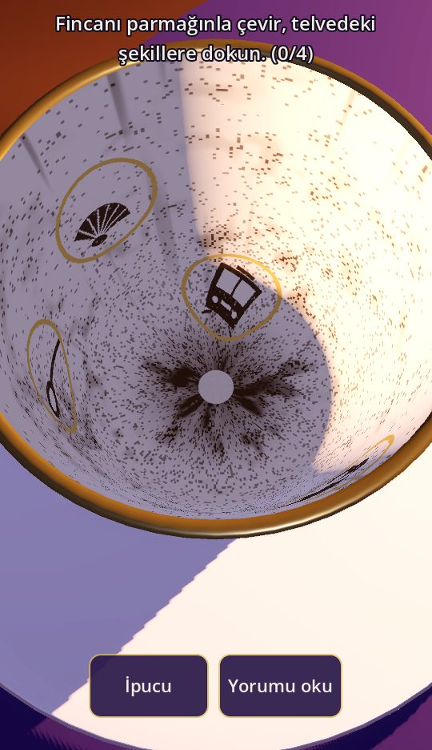
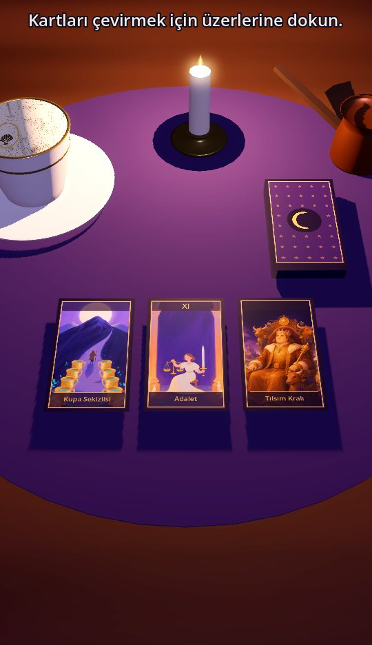
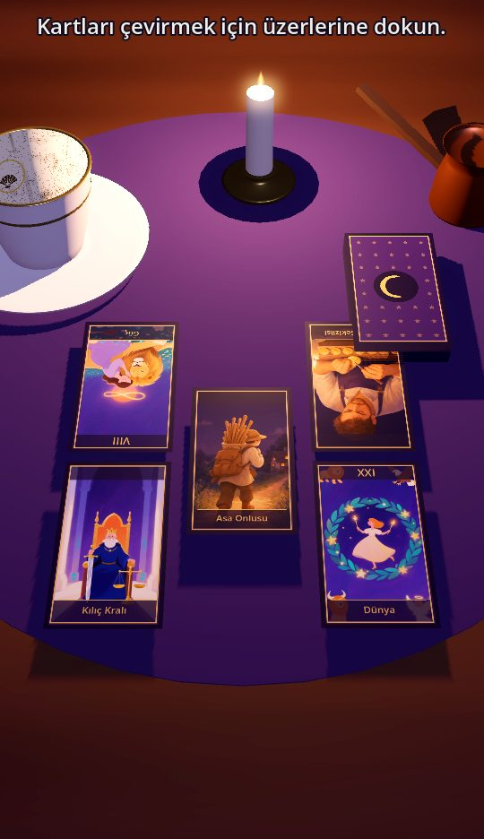
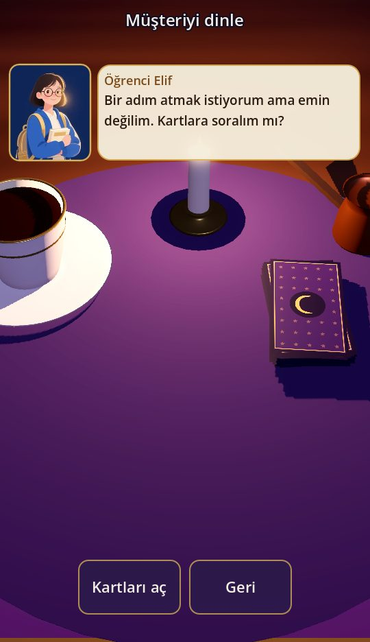
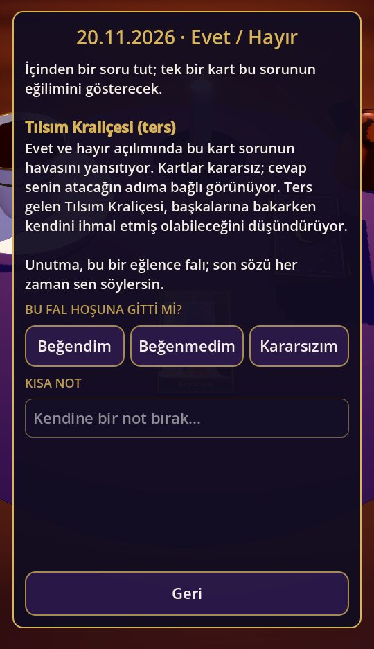

# Seerlune: Coffee Cup & Tarot

A cozy 3D entertainment game for Android set at a small candlelit table: read a Turkish coffee cup, lay out tarot cards, and run your own little fortune parlour. Plays offline.

[Türkçe](#türkçe) · [Privacy policy](privacy.md)

  
  
  

  
  
  

Table · Coffee cup · Tarot · Spread · Parlour · Journal

**For entertainment only.** Readings are built inside the game from texts written in advance; they are not a real prediction and say nothing about the future.

## Download

- **Android:** coming to Google Play.

## Features

- **Card of the day:** a card waits on the table every day and renews tomorrow.
- **Coffee cup:** sip your coffee, turn the cup over, leave a wish and open it. Find 120 different shapes in the grounds; each one reads differently depending on where it sits in the cup. A saucer-and-wish reading is free for everyone.
- **Tarot:** the full 78-card deck, each card with its own artwork, and five spreads: single card, yes/no, past–present–future, love and decision. Reversed cards can be switched on or off.
- **Fortune parlour:** guests arrive with a question; open the cards or the cup and choose the best reading piece for each one. Earn stars and in-game tips, and unlock tablecloth and cup colours. No timer, no lives.
- **Reading journal:** every reading is saved with its date and topic, with the same text you got that day. Mark it and add your own note.
- **Offline and private:** no account, no photos, no servers of ours. English and Turkish.

The game is free and contains ads: an occasional full-screen ad after a reading, and an optional rewarded ad that doubles an in-game tip in the parlour. No part of a reading is ever sold or unlocked with ads. A one-time "No Ads" purchase and optional colour packs are available through Google Play. Intended for ages 18 and over.

## Support

luneapps.support@gmail.com

Built with Godot Engine (MIT license) and Godot Google Play Billing (MIT license); ads by the Google Mobile Ads SDK. Card and portrait art was generated with the Qwen-Image model (Apache 2.0) and hand-picked. Reading texts, the 3D table, sound effects and music were made for this game. Full third-party notices are in the game under Settings → Licenses and credits.

This repository holds the documentation only; the source code is not published here.

---

## Türkçe

# Seerlune: Fincan & Tarot

Mum ışığıyla aydınlanan küçük bir masada geçen, rahat bir 3B eğlence oyunu: Türk kahvesi fincanına bak, tarot kartlarını aç, kendi küçük fal dükkânını işlet. İnternetsiz oynanır.

[Gizlilik politikası](privacy.md#türkçe)

**Yalnızca eğlence içindir.** Fallar oyun içinde önceden yazılmış metinlerden üretilir; gerçek bir öngörü değildir ve geleceğe dair bilgi içermez.

### İndir

- **Android:** yakında Google Play'de.

### Özellikler

- **Günün kartı:** her gün masada seni bir kart bekler, ertesi gün yenilenir.
- **Kahve falı:** kahveni yudumla, fincanı kapat, dileğini bırak ve aç. Telvede 120 farklı şekil var; her biri fincanda durduğu yere göre farklı yorumlanır. Tabak ve dilek yorumu herkese ücretsizdir.
- **Tarot:** 78 kartlık destenin tamamı, her kart için ayrı çizim ve beş açılım: tek kart, evet/hayır, geçmiş–şimdi–gelecek, aşk ve karar. Ters kartlar açılıp kapatılabilir.
- **Fal dükkânı:** müşteriler sorularıyla gelir; kartları ya da fincanı açıp her biri için en uygun yorum parçasını seçersin. Yıldız ve oyun içi bahşiş kazan, masa örtüsü ve fincan renklerini aç. Süre ve can yok.
- **Fal günlüğü:** her fal tarihi ve konusuyla, o gün çıkan metnin aynısıyla kaydedilir. İşaretleyebilir, kendi notunu ekleyebilirsin.
- **İnternetsiz ve gizli:** hesap yok, fotoğraf yok, bizim sunucumuz yok. Türkçe ve İngilizce.

Oyun ücretsizdir ve reklam içerir: bir falın ardından seyrek bir tam ekran reklam ve dükkânda oyun içi bahşişi ikiye katlayan isteğe bağlı ödüllü reklam. Falın hiçbir parçası satılmaz ya da reklamla açılmaz. Google Play üzerinden tek seferlik "Reklamsız" ve isteğe bağlı renk paketleri alınabilir. 18 yaş ve üzeri içindir.

### Destek

luneapps.support@gmail.com

Godot Engine (MIT lisansı) ve Godot Google Play Billing (MIT lisansı) ile yapıldı; reklamlar Google Mobile Ads SDK ile gelir. Kart ve portre çizimleri Qwen-Image modeliyle (Apache 2.0) üretilip elle seçildi. Fal metinleri, 3B masa, ses efektleri ve müzik bu oyun için yapıldı. Üçüncü taraf bildirimlerinin tamamı oyunda Ayarlar → Lisanslar ve emeği geçenler bölümündedir.

Bu depo yalnızca belgeleri içerir; kaynak kod burada yayımlanmaz.
